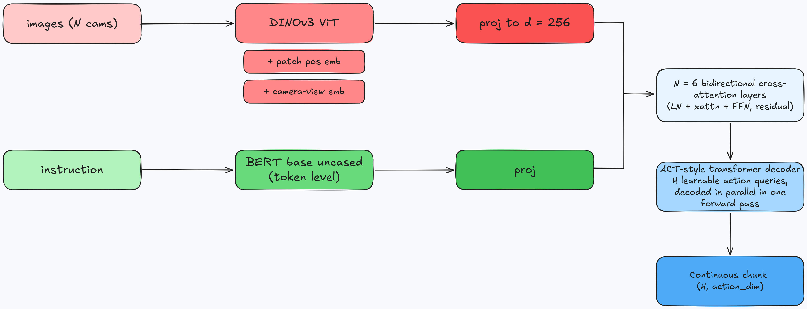

# lerobot_policy_turbovla_so101

<p align="left">
  <a href="https://pypi.org/project/lerobot-policy-turbovla-so101/"></a>
  <a href="https://pypi.org/project/lerobot-policy-turbovla-so101/"></a>
  <a href="https://github.com/ravediamond/lerobot-policy-turbovla-so101/actions/workflows/ci.yml"></a>
  <a href="https://github.com/ravediamond/lerobot-policy-turbovla-so101/blob/main/LICENSE"></a>
  <a href="https://arxiv.org/abs/2607.27205"></a>
</p>

TurboVLA as a standalone [LeRobot](https://github.com/huggingface/lerobot) policy plugin, trained
and tested end-to-end on a real [SO-101](https://github.com/TheRobotStudio/SO-ARM100) arm, not
just simulation. Since v0.3.0 the network **is the authors' own code** (vendored from
[`H-EmbodVis/TurboVLA`](https://github.com/H-EmbodVis/TurboVLA) @ `a3365e8`), with a parity test that checks the
plugin reproduces upstream's outputs, and the released LIBERO checkpoint loads into it.

Write-ups of the real-arm runs: [TurboVLA: a policy that ignored its instruction](https://shissorobotics.com/blog/2026/10/08/turbovla-a-policy-that-ignored-its-instruction/) and [Paper vs hardware 12: TurboVLA](https://shissorobotics.com/blog/2026/10/23/paper-vs-hardware-turbovla/) on [shissorobotics.com](https://shissorobotics.com/papers/).

> **Status (v0.3.0): faithful port, real-arm results to redo.** Up to v0.2.0 this plugin was *not* the paper's
> model: it differed from upstream in six places (table below), and every real-arm result in [Results](#results) comes
> from that port. v0.3.0 replaces the network with upstream's own code. A faithful run with upstream's own trainer
> on the same data also ignored the instruction, so the old conclusion is expected to hold at the paper's 12-step chunk;
> the open question is whether a longer chunk (the paper uses 50 steps on RoboTwin) fixes it.

```bash
lerobot-train --policy.type=act              ...   # before
lerobot-train --policy.type=turbovla_so101   ...   # after
```

Everything else in the workflow — record, train, rollout — stays identical. This registers a
policy and lets `lerobot-train` drive it; no fork of LeRobot itself, no custom harness.

## Contents

- [TurboVLA vs ACT: the idea, and what happened](#turbovla-vs-act-the-idea-and-what-happened)
- [Architecture](#architecture)
- [Install](#install)
- [Train](#train)
- [Configuration](#configuration)
- [Results](#results)
- [Dataset requirements](#dataset-requirements)
- [Benchmarks and evaluation](#benchmarks-and-evaluation)
- [Tests](#tests)
- [Citation](#citation)
- [Attribution](#attribution)
- [License](#license)

## TurboVLA vs ACT: the idea, and what happened

The idea was the same ergonomics as ACT (chunked continuous actions, parallel decode, L1 loss), but language
conditioned:

|                 | ACT                    | TurboVLA                            |
| --------------- | ---------------------- | ------------------------------------ |
| Language        | none                   | BERT token-level, fused into vision  |
| Visual backbone | ResNet18                | DINOv3 ViT-B                        |
| Action decode   | parallel chunk queries  | parallel chunk queries (same idea)  |
| Params          | ~80M                    | ~0.2B                                |

The hoped-for win on a multi-task arm dataset: ACT ignores the task string, so you need one
checkpoint per task, while TurboVLA conditions on it, so one checkpoint could cover many tasks.

In practice it didn't hold up. On a real SO-101 the trained checkpoints barely react to the
instruction (about 0.2 degrees of change in the predicted actions when the instruction is swapped),
so the language conditioning, the whole reason to pick it over ACT, doesn't work on this kind of
task. A single-task ACT is the better choice here, and for language-conditioned multi-task work a
VLM-based policy like SmolVLA did work on the same rig. Details in [Results](#results).

Upstream research code: <https://github.com/H-EmbodVis/TurboVLA>; paper
[arXiv:2607.27205](https://arxiv.org/abs/2607.27205). Only the modules were ported here, not the
harness. The upstream is built around its own trainer, TFDS/RLDS for LIBERO, and a `flash-attn`
dependency this package avoids.

## Architecture



The network is upstream's `TurboVLA` module, vendored unchanged in
[`src/lerobot_policy_turbovla_so101/upstream/`](src/lerobot_policy_turbovla_so101/upstream) (Apache-2.0; each file's
header lists what was touched: import paths, building backbones offline, and two transformers-5 compatibility fixes).
Parameter names are upstream's, so upstream checkpoints load directly.

- **DINOv3 ViT-B/16 per camera, trainable**, 256 px → VisionProjection (LayerNorm, MLP + linear skip, LayerNorm) + a
  learned view embedding.
- **Frozen BERT-base** with Grounding DINO's sub-sentence attention masks (split on `[CLS]`/`[SEP]`/`.`/`?`), padded to
  21 tokens → linear projection.
- **6 interaction layers**, each a Grounding-DINO `BiAttentionBlock` (one shared vision-text affinity, softmaxed both
  ways; layer-scale initialised at 1e-4; drop-path 0.1) followed by a text self-attention layer.
- **Robot state → 2 tokens appended to the fused memory** (not to the vision tokens before fusion).
- **ACT-style decoder**: 3 pre-norm layers, FFN 2048, 12 learned queries → 3-layer MLP → `tanh`. Actions are min-max
  normalised to [-1, 1]; state is z-scored. Masked L1 loss.

### What changed from v0.2.0 (the port the old results come from)

| # | Upstream (= v0.3.0) | v0.2.0 port |
|---|---|---|
| 1 | Interaction layers from Grounding DINO / the LIBERO checkpoint | random init |
| 2 | `BiAttentionBlock` (shared affinity, layer-scale 1e-4) + text self-attention | two independent cross-attentions, full residuals, no text self-attention |
| 3 | state → 2 tokens into the decoder memory, after fusion | 1 token prepended to the vision tokens, through all 6 fusion layers |
| 4 | VisionProjection MLP, 3 decoder layers, FFN 2048, MLP head + tanh, 256 px, DINOv3 trainable | one Linear, 4 layers, FFN 1024, linear head, 224 px, DINOv3 frozen |
| 5 | actions min-max to [-1, 1] (tanh head) | mean/std |
| 6 | AdamW default betas (0.9, 0.999), warmup 0.1→1 then constant LR | betas (0.9, 0.95), cosine decay |

Two traps found while porting to transformers 5 (both covered by `tests/test_upstream_parity.py`): DINOv3's
`hidden_states[-1]` is the *pre*-norm output in transformers 5 but the normalised one in 4.56 (upstream's version), so
the plugin reads `last_hidden_state`; and transformers 5 nests DINOv3's blocks under `.model`, which the checkpoint
loader maps explicitly.

## Install

Requires Python ≥ 3.12.

```bash
pip install lerobot_policy_turbovla_so101
```

`lerobot` and `transformers` come along as dependencies, and `--policy.type=turbovla_so101`
works immediately — see [Train](#train).

### If you are on a torch build pip cannot reproduce

A ROCm build, a nightly, or a source build. pip cannot re-fetch that torch from PyPI, and `lerobot`
pins `torch<2.12.0` — so a torch outside that range does not satisfy the pin, and a plain install
**uninstalls your build and drops a CUDA wheel in its place**, along with ~4 GB of `nvidia-*`
packages. Install the packages that pin torch with `--no-deps`, and let the rest resolve normally.

```bash
# 1. the three packages that pin torch — installed without their dependency graph
pip install --no-deps lerobot torchcodec lerobot_policy_turbovla_so101

# 2. lerobot's remaining dependencies, which are harmless. Derive the list rather
#    than transcribing it, so it stays correct across lerobot versions:
python - <<'EOF' > /tmp/deps.txt
from importlib.metadata import requires
from packaging.requirements import Requirement
skip = {"torch", "torchvision", "torchcodec", "triton"}
for r in requires("lerobot") or []:
    req = Requirement(r)
    if (req.marker and not req.marker.evaluate()) or req.name.lower() in skip:
        continue
    print(req)
EOF
pip install -r /tmp/deps.txt "transformers>=5.4.0,<5.6.0"

# 3. confirm your torch survived
python -c "import torch; print(torch.__version__)"
```

pip then prints a dependency-conflict warning about `torch<2.12.0`. It is advisory; the policy
runs fine on newer torch.

To make this durable, pin torch in a constraints file so any future pip command in the
environment fails loudly instead of replacing it:

```bash
python -c "import torch, torchvision; print(f'torch=={torch.__version__}\ntorchvision=={torchvision.__version__}')" \
  > ~/.config/pip/torch-constraints.txt
export PIP_CONSTRAINT=~/.config/pip/torch-constraints.txt
```

To work on the package itself, `pip install -e ".[test]"` from a clone.

Verify discovery:

```bash
python -c "
from lerobot.utils.import_utils import register_third_party_plugins
from lerobot.configs import PreTrainedConfig
register_third_party_plugins()
assert 'turbovla_so101' in PreTrainedConfig.get_known_choices()
print('ok')"
```

The distribution name must stay `lerobot_policy_turbovla_so101`.

### The DINOv3 weights are gated

The default `facebook/dinov3-vitb16-pretrain-lvd1689m` is a **gated** repo. Accept the terms on the
model page, then authenticate:

```bash
hf auth login          # or: export HF_TOKEN=...
```

Without that you get a 401 at model construction. Two ways around it:

```bash
# 1. Use an ungated backbone instead (any patch-based ViT that AutoModel can load).
--policy.vision_backbone=facebook/dinov2-base

# 2. Skip pretrained weights entirely — random init for smoke tests only.
--policy.load_pretrained_backbones=false
```

## Train

### The paper's real-robot recipe: start from the LIBERO checkpoint

```bash
lerobot-train \
  --dataset.repo_id=${HF_USER}/so101_bowls_all_trimmed \
  --policy.type=turbovla_so101 \
  --policy.upstream_init_checkpoint=hf://H-EmbodVis/TurboVLA/checkpoints/libero/turbovla_libero.pth \
  --policy.camera_order='[observation.images.front_top_camera,observation.images.wrist_camera]' \
  --policy.device=cuda --policy.push_to_hub=false \
  --batch_size=64 --steps=35000 \
  --output_dir=outputs/train/turbovla_so101
```

Every tensor whose shape matches is loaded; the robot-dependent ones (state / action width, and the action queries if
`chunk_size` != 12) keep their fresh init, and the log lists them. Put the third-person camera first in
`camera_order`: LIBERO's view 0 is the third-person view, view 1 the wrist. The init checkpoint is only read when
training starts; a trained policy reloads without it. The paper fine-tunes its real-robot policies from this
checkpoint (12.5k steps on 4 × 65 demos).

Memory: DINOv3 is trained, so batch 128 does not fit 24 GB; batch 64 does (0.78 s/step on an RTX PRO 4000).

### Longer chunks, state dropout

```bash
  --policy.chunk_size=50 --policy.n_action_steps=50     # the paper's RoboTwin horizon
  --policy.state_dropout_prob=0.3                       # plugin-only, not in the paper; off by default
```

### Multi-GPU

`lerobot-train` supports `torchrun --nproc_per_node=N`, and `--batch_size` is then per rank (upstream's LIBERO recipe
is a global batch of 128). Resume works as usual:

```bash
lerobot-train --config_path=outputs/train/turbovla_so101/checkpoints/last/pretrained_model/train_config.json --resume=true
```

## Configuration

Defaults are upstream's released LIBERO recipe (`experiments/libero/README.md` and the trainer's defaults).

| Flag | Default | Notes |
|---|---|---|
| `--policy.upstream_init_checkpoint` | `null` | upstream `.pth`, local or `hf://repo/file`; the paper's real-robot runs use the LIBERO one |
| `--policy.chunk_size` / `n_action_steps` | `12` / `12` | `H`; the paper uses 50 on RoboTwin |
| `--policy.camera_order` | dataset order | index of the view embedding; third-person first for the LIBERO init |
| `--policy.image_size` | `256` | frames are resized (bilinear, antialiased) inside the policy |
| `--policy.freeze_vision_backbone` / `freeze_language_backbone` | `false` / `true` | as upstream |
| `--policy.vision_backbone` | `facebook/dinov3-vitb16-pretrain-lvd1689m` | gated, see Install |
| `--policy.language_backbone` | `google-bert/bert-base-uncased` | |
| `--policy.text_padding_length` | `21` | upstream's fixed text length |
| `--policy.dim_model`, `n_heads`, `n_interaction_layers` | `256`, `8`, `6` | |
| `--policy.n_decoder_layers`, `dim_feedforward` | `3`, `2048` | |
| `--policy.optimizer_lr` / `optimizer_lr_backbone` | `5e-5` / `5e-5` | upstream's head / DINOv3 groups |
| `--policy.optimizer_weight_decay` | `1e-10` | weight matrices only, as upstream |
| `--policy.scheduler_warmup_steps` / `scheduler_min_lr_ratio` | `10000` / `1.0` | upstream's schedule (constant after warmup) |
| `--policy.state_dropout_prob` | `0.0` | plugin-only; not in the paper |
| `--policy.temporal_ensemble_coeff` | `null` | ACT-style chunk blending; requires `n_action_steps=1` |

## Results

**No checkpoint solves the real-arm task I trained it on.** The table is from the **v0.2.0 port** (not the paper's
model, see [Architecture](#what-changed-from-v020-the-port-the-old-results-come-from)); real SO-101 (Jetson Orin NX and
M1 Mac), one rig, one dataset, small trial counts. Offline only, upstream's own code and trainer on the same data
(LIBERO init, 35k steps, batch 64) ignored the instruction as well: task swap 0.02°, per-layout probe 39% (chance),
while the released checkpoint does react to instructions on LIBERO-Goal. v0.3.0 has not been run on the arm yet.

Task: [`ravediamond/so101_bowls_all`](https://huggingface.co/datasets/ravediamond/so101_bowls_all), 182 teleop
episodes, two instructions ("Put the blue bowl in the pink bowl." / "Put the pink bowl in the blue bowl.") over the
same scenes, so only the instruction tells the policy which bowl to move. Trials are 25 s, blue into pink.

| Policy | Checkpoint | Real arm |
|---|---|---|
| TurboVLA, 35k steps | [`turbovla_so101_bowls`](https://huggingface.co/ravediamond/turbovla_so101_bowls) | never leaves the rest pose |
| + idle starts trimmed (5k fine-tune) | [`turbovla_so101_bowls_trimmed`](https://huggingface.co/ravediamond/turbovla_so101_bowls_trimmed) | 1/10 |
| + single-task fine-tune (blue into pink only) | [`turbovla_so101_bowls_blue_in_pink`](https://huggingface.co/ravediamond/turbovla_so101_bowls_blue_in_pink) | 1/4 |
| + relabelled instructions, paired batches | [`turbovla_so101_bowls_relabeled_paired`](https://huggingface.co/ravediamond/turbovla_so101_bowls_relabeled_paired) | 0/2 |
| fresh, paper optimizer recipe (v0.2.0) + EMA | [`turbovla_so101_bowls_v2`](https://huggingface.co/ravediamond/turbovla_so101_bowls_v2) | 0/3 |
| ACT (single task, reference) | | 10/10 M1, 9/10 Orin NX |
| SmolVLA (both tasks, reference) | | 9/10 M1, 9/10 Orin NX |

What goes wrong, consistently across every variant:

- **The instruction barely changes the actions.** Swapping blue and pink in the instruction moves the predicted chunk
  by 0.1 to 0.35 degrees, against 7 to 13 degrees for SmolVLA on the same frames. The text path is not dead (the
  decoder attends to text tokens and an auxiliary "which bowl" head on the decoder states reaches 98% accuracy), but
  the action head does not use it.
- **On the arm** that shows up as a task coin flip or a position habit (v2 went to the right hand bowl in all three
  tries, also with the bowls swapped) and as hesitation: hovering at the rim with the gripper open instead of grasping.
- The likely cause is the short horizon: with 12 steps (0.4 s) and the arm state as input, the instruction is needed
  on only about 6% of training frames, so the cheapest fit continues the arm's current motion. A longer chunk
  (50 to 100 steps, as SmolVLA and ACT use), state dropout, or a multimodal action head are the untested next steps.

Inference on the arm (Orin NX, `lerobot-jetson` Docker, sync inference): ~119 ms per 12-action chunk, ~24.5 Hz
control loop, 828 MB torch memory peak.

Architecture-only latency (synthetic inputs) is in
[`benchmarks/results/latency_jetson_orin_nx.md`](benchmarks/results/latency_jetson_orin_nx.md) for
TurboVLA vs ACT vs SmolVLA on a Jetson Orin NX 16GB. TurboVLA is 5.5x slower than ACT and 7.0x
faster than SmolVLA per chunk, same ranking as reported elsewhere on discrete GPUs.

## Dataset requirements

- At least one `observation.images.*` key (several = several views, one view embedding each).
- `observation.state` (required: it conditions the action decoder).
- A task string per episode: the instruction.

## Benchmarks and evaluation

`benchmarks/` holds dataset-agnostic tooling for comparing this policy against others. Nothing in it
is specific to a particular dataset or robot — pass a different `--dataset` and it works.

**Inference latency** (`bench_latency.py`) — no dataset and no training required; it builds each
policy from its config and times `predict_action_chunk` on synthetic inputs of matched shape.

```bash
python benchmarks/bench_latency.py --policies turbovla_so101 act smolvla --resolution 224
```

Reports per-chunk and per-env-step latency, VRAM, and parameter count. See the module docstring for
the protocol (warmup, synchronization, median-not-mean) and for why quoting only the amortized
per-step number is the flattering half of the story.

**Held-out action error, per task** (`eval_per_task.py`) — recomputes the same train/eval episode
split `lerobot-train` uses, then scores any number of checkpoints on the held-out frames.

```bash
python benchmarks/eval_per_task.py \
    --dataset <hub-id> --eval-split 0.2 --resize 224 \
    --checkpoint turbovla_so101=outputs/a/checkpoints/last/pretrained_model \
    --checkpoint act=outputs/b/checkpoints/last/pretrained_model
```

Results are broken out per task rather than reduced to one number, because a multi-task dataset
mixes tasks a language-blind policy can solve from pixels with tasks it cannot, and averaging lets
the first kind hide the second.

**Held-out MAE across a training run** (`eval_curve.py` + `plot_curves.py`) — scores every numbered
checkpoint of a run instead of just the last one, so the `Results` section above can report a real
learning curve rather than a single end-of-training number that might be an overfit peak or a run
cut short mid-descent.

```bash
python benchmarks/eval_curve.py \
    --dataset <hub-id> --eval-split 0.2 --resize 224 \
    --run turbovla_so101=outputs/cmp_turbovla_so101 --json benchmarks/results/curves.json

pip install -e ".[plots]"
python benchmarks/plot_curves.py \
    --loss-log outputs/cmp_turbovla_so101.log \
    --mae-json benchmarks/results/curves.json \
    --out benchmarks/results/curves.png
```

Training loss (parsed from the `lerobot-train` log) and held-out MAE are plotted side by side: loss
shows whether the run actually converged, MAE shows whether it converged to something that predicts
well on data it never trained on. `--run` also accepts several `NAME=DIR` entries to compare against
baseline runs (e.g. ACT) trained under the same protocol, at a shared horizon.

**Counterfactual instruction test** (`eval_instruction_sensitivity.py`) — the direct test of whether
a policy uses the instruction at all. It runs the policy twice on identical pixels, once with the
recorded instruction and once with a paired one, and reports whether swapping the sentence actually
costs accuracy. A policy with no language input scores exactly zero divergence, which doubles as a
sanity check on the harness.

```bash
python benchmarks/eval_instruction_sensitivity.py \
    --dataset <hub-id> --eval-split 0.2 --resize 224 \
    --checkpoint turbovla_so101=outputs/a/checkpoints/last/pretrained_model \
    --pair "put the block in the blue bin" "put the block in the green bin"
```

The `--pair` arguments are the one thing you must supply per dataset: only you know which tasks
share a scene and differ solely in the sentence. Automatic detection is deliberately not trusted
here — a pair differing by a *visible* attribute is still solvable from pixels and would pollute the
result.

**Equalizing input resolution** (`resize224.yaml` + `train_with_yaml.py`) — when comparing against a
policy whose backbone consumes native resolution, equalize it so the comparison isolates the
variable you care about:

```bash
python benchmarks/train_with_yaml.py benchmarks/resize224.yaml \
    --dataset.repo_id=<hub-id> --policy.type=act --eval_steps=0 ...
```

Read that file's header before using it: LeRobot applies image transforms to the training dataset
only, so a run using the overlay must set `--eval_steps=0` and evaluate with `eval_per_task.py`
instead.

## Tests

```bash
pip install -e ".[test]"
pytest -q
```

Everything runs on CPU against tiny local backbones: no Hub access, no GPU. `tests/test_upstream_parity.py` loads a
reference made with upstream's own code on transformers 4.56 (`tests/parity/make_upstream_reference.py`, rerun it
against the pinned upstream commit to regenerate) and requires the plugin to reproduce its fused features and action
chunks within 1e-5.

## Citation

This package is an independent LeRobot integration, not affiliated with the paper's authors. If
TurboVLA itself is useful in your research, cite the paper:

```bibtex
@article{xie2026turbovla,
  title  = {TurboVLA: Real-Time Vision-Language-Action Model at
            32 Hz on an RTX 4090 with <1 GB VRAM},
  author = {Xie, Hengyi and Yao, Chenfei and Wu, Xianjin and
            Xi, Xuanyang and Tang, Yiping and Xu, Di and
            Zhu, Yingying and Liang, Dingkang and Bai, Xiang and
            Ding, Han},
  journal = {arXiv preprint arXiv:2607.27205},
  year   = {2026}
}
```

## Attribution

The network in `src/lerobot_policy_turbovla_so101/upstream/` is vendored from
[`H-EmbodVis/TurboVLA`](https://github.com/H-EmbodVis/TurboVLA) @ `a3365e8` (Apache-2.0, which in turn includes
Grounding DINO and DETR code); see `NOTICE` and `upstream/LICENSE.upstream`. Up to v0.2.0 parts of this package were
adapted from [`ez1540/turbovla-lerobot-plugin`](https://github.com/ez1540/turbovla-lerobot-plugin). This repository
adds the LeRobot integration (config, processors, upstream-checkpoint loading, upstream's optimiser groups and
schedule), the parity tests, temporal ensembling for rollout, and validation on a real SO-101 arm.

## License

Apache-2.0. See `LICENSE` and `NOTICE`.
